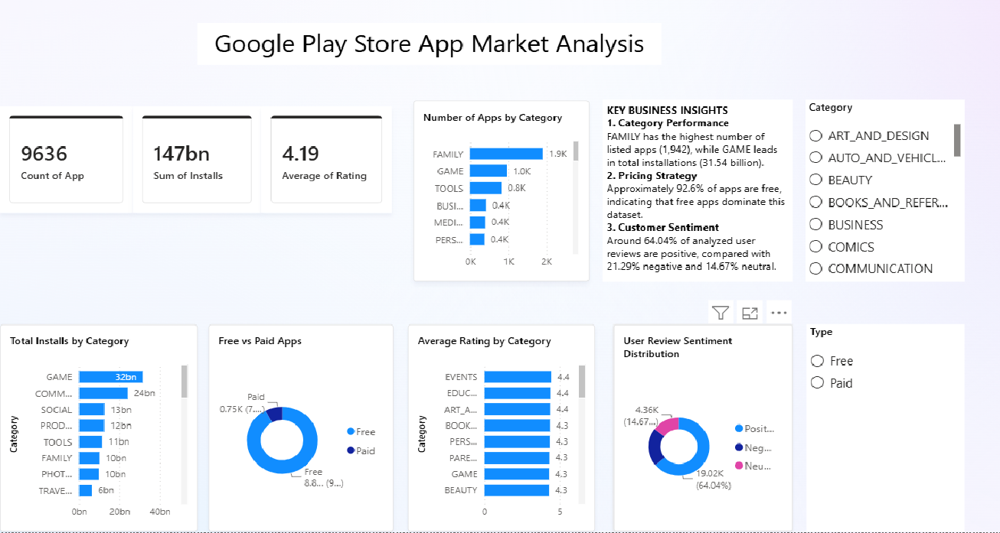

 # Google Play Store App Market Analysis

## Project Overview

This project focuses on analyzing Google Play Store apps to understand app distribution, popularity, ratings, pricing, and user review sentiment.

The goal is to explore the app market, identify patterns, and present meaningful business insights using Python and Power BI.

## Tools & Technologies

- Python
- Pandas
- NumPy
- Matplotlib
- Seaborn
- Jupyter Notebook
- Power BI

## Data Cleaning

The Google Play Store dataset was cleaned using Python and Pandas.

The following steps were performed:

- Removed duplicate app records.
- Handled missing values without unnecessarily filling them.
- Removed an invalid data row.
- Converted Reviews and Installs into numeric formats.
- Cleaned the Price column by removing currency symbols.
- Standardized app Size values into MB.
- Converted Last Updated into a date format.
- Checked the dataset for remaining missing values and duplicates.

The cleaned app dataset contains 10,355 rows and 13 columns.

## Exploratory Data Analysis (EDA)

Exploratory Data Analysis was performed to identify patterns and trends in the Google Play Store dataset.

The analysis focused on:

- Identifying categories with the highest and lowest number of apps.
- Comparing app installations across categories.
- Analyzing the distribution of free and paid apps.
- Comparing average ratings across app categories.
- Exploring the relationship between app reviews and installations.

### Key Findings

- FAMILY had the highest number of listed apps (1,942).
- GAME recorded the highest total installations (approximately 31.54 billion).
- Free apps dominated the dataset.
- The overall average app rating was approximately 4.19.
- App reviews and installations showed a positive correlation.

## User Review Sentiment Analysis

The Google Play Store user reviews dataset was analyzed to understand customer opinions about mobile applications.

The following steps were performed:

- Removed reviews with missing review text.
- Removed duplicate review records.
- Analyzed the distribution of Positive, Negative, and Neutral sentiments.
- Identified apps with the highest counts of positive and negative reviews.

### Sentiment Analysis Results

| Sentiment | Reviews | Percentage |
|---|---:|---:|
| Positive | 19,015 | 64.04% |
| Negative | 6,321 | 21.29% |
| Neutral | 4,356 | 14.67% |

**Key Finding:** Positive reviews represented the largest share of the analyzed user reviews.

## Power BI Dashboard

An interactive dashboard was created using Power BI to present the key findings of the analysis.

The dashboard includes:

- Total number of apps.
- Total installations.
- Average app rating.
- Number of apps by category.
- Total installations by category.
- Free vs. paid app distribution.
- Average rating by category.
- User review sentiment distribution.

### Dashboard Interactivity

- Category slicer to filter apps by category.
- App type slicer to compare free and paid apps.

## Dataset Source and Attribution

The datasets used in this project were obtained from Kaggle.

Two datasets were used:
- Google Play Store Apps dataset.
- Google Play Store User Reviews dataset.

The dataset license provided with the project is **Creative Commons Attribution 3.0 Unported (CC BY 3.0)**.

Original dataset creator and source URL should be credited here once confirmed.

## Dataset Source and Attribution

The datasets used in this project were obtained from Kaggle:

- **Dataset:** [Google Play Store Apps](https://www.kaggle.com/datasets/lava18/google-play-store-apps)
- **Creator:** lava18
- **License:** Creative Commons Attribution 3.0 Unported (CC BY 3.0)

The project uses the Google Play Store Apps dataset and its associated user reviews dataset for analysis.

Credit is given to the original dataset creator.

## Power BI Dashboard

[Download Power BI Dashboard (.pbix)](Google_Play_Store_Analysis.pbix)

